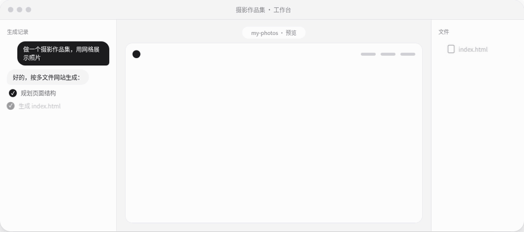
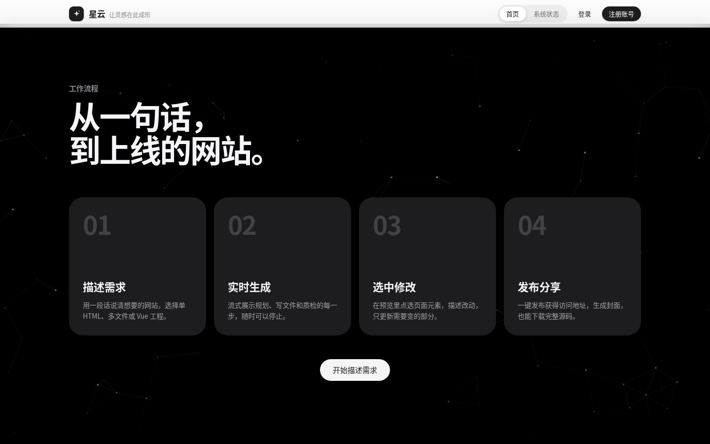
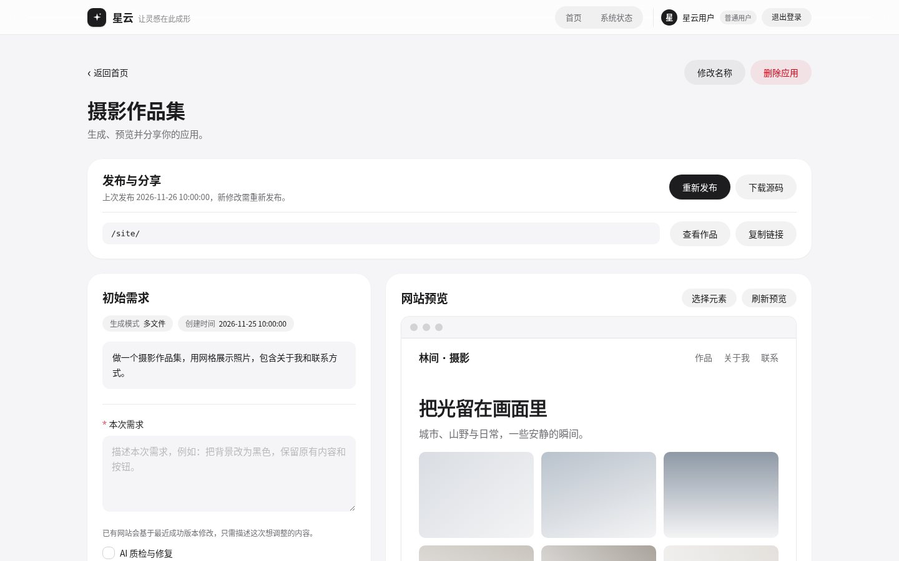
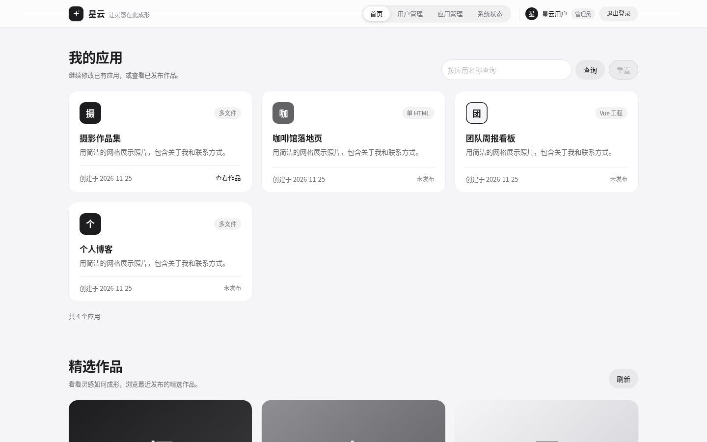
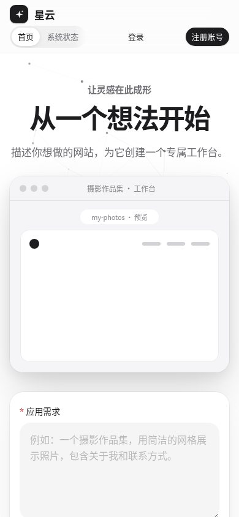
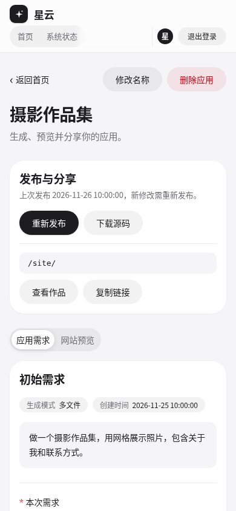
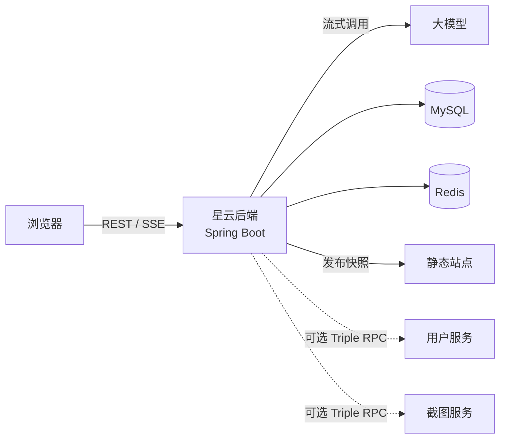

<p align="center">
  
</p>

<h1 align="center">星云 · XY</h1>

<p align="center">
  <b>从一个想法开始。</b><br />
  描述你想做的网站，AI 写好代码、实时预览，一键发布成可以分享的链接。
</p>

<p align="center">
  <a href="https://xy.xiaoxy.com/"></a>
  
  
  
  
  
  <a href="LICENSE"></a>
</p>

<p align="center">
  <a href="https://xy.xiaoxy.com/"><b>打开星云 →</b></a>
</p>

<p align="center">
  
</p>
<p align="center"><sub>首页演示：描述需求 → 生成网站 → 选中元素再改 → 发布分享</sub></p>

**星云（Xing Yun）** 是一个零代码应用搭建平台，名字取拼音首字母 **XY**。不用写一行代码，把想法说清楚，就能得到一个能打开、能分享的网站。

## 从一句话，到上线的网站



| 步骤 | 你做什么 | 星云做什么 |
| --- | --- | --- |
| 描述需求 | 用一句话说出想要的网站 | 自动判断适合单 HTML、多文件还是 Vue 工程 |
| 实时生成 | 看着代码一点点写出来 | 流式输出 HTML、CSS、JS，完成后在沙箱里预览 |
| 选中修改 | 在预览里点选一个元素，说想怎么改 | 带着对话上下文和已有源码做增量修改，不推倒重来 |
| 发布分享 | 点「发布」 | 保存网页快照、生成封面，给出稳定的分享链接 |

## 工作台

每个应用都有自己的工作台：左边写需求、看生成记录，右边是可以交互的网站预览。



- **多轮修改**：成功后接着提下一个需求；失败或主动停止时保留需求，方便重试。
- **AI 质检**：可选开启，生成后自动检查，发现问题最多自动修一次。
- **断了也能接上**：刷新或重新进入，生成记录、预览和发布信息都会恢复。
- **源码归你**：随时下载最近成功版本的源码压缩包。

## 我的应用与精选作品



首页列出你创建过的应用；被设为精选的公开作品会出现在「精选作品」里，供所有人浏览。

## 在手机上，也一样好用

<p align="center">
  
  &nbsp;&nbsp;
  
</p>

## 技术栈

| 层 | 选型 |
| --- | --- |
| 前端 | Vue 3 · TypeScript · Vite · Ant Design Vue · Pinia |
| 后端 | Java 21 · Spring Boot 3.5 · MyBatis-Flex · Knife4j |
| AI | LangChain4j，接 OpenAI 兼容接口或通义千问；流式输出与工具调用 |
| 数据 | MySQL 8 · Redis（登录会话、生成限流、精选缓存、对话记忆） |
| 可选拆分 | Dubbo Triple · Nacos · Higress 网关 · Prometheus 与 Grafana |



默认是一个后端进程；用户服务和截图服务可以按需拆出去单独部署，拆分方式见开发文档。

## 快速开始

需要 JDK 21、MySQL 8、Redis 和 Node.js 22.13 以上。

1. 在 MySQL 中依次执行 [`backend/sql/`](backend/sql) 下的建表脚本。
2. 复制 `backend/src/main/resources/application.example.yml` 为同目录的 `application.yml`，填好数据库和 Redis。要用生成功能，在 `xy.ai` 下填写 `base-url`、`api-key`、`model-name`，并把 `enabled` 设为 `true`。
3. 用 IDEA 打开 `backend/pom.xml`，运行 `com.xy.MainApplication`，后端监听 `8101`。
4. 启动前端：

   ```sh
   cd frontend
   npm ci
   npm run dev
   ```

5. 打开 <http://127.0.0.1:5173>，在首页写下第一个想法。

完整的环境要求、配置项、微服务拆分和验收步骤见 [开发文档](docs/development.md)。

## 文档

- [开发文档](docs/development.md)：配置、启动、测试与验收
- [需求范围](docs/spec.md) · [界面设计](docs/design.md) · [依赖说明](docs/NOTES.md)
- [Redis 部署](docs/redis-deployment.md) · [开发约定](AGENTS.md)

## 许可证

[MIT](LICENSE) © 2026 hollegjx
